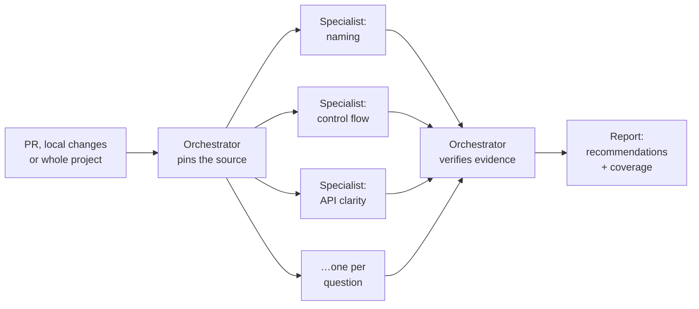

<p align="center">
  
</p>

<p align="center">
  <b>AI code review for readable, maintainable Go, TypeScript, Rust and Java code</b><br>
  Claude Code · Codex · Cursor · OpenCode
</p>

<p align="center">
  <a href="https://github.com/Dankosik/super-review/releases"></a>
  <a href="https://github.com/Dankosik/super-review/actions/workflows/validate.yml"></a>
  <a href="LICENSE"></a>
  
</p>

<p align="center">
  <a href="#quick-start">Quick start</a> ·
  <a href="#what-it-reviews">What it reviews</a> ·
  <a href="#how-it-works">How it works</a> ·
  <a href="#defect-review-experimental-rust">Defect Review</a> ·
  <a href="#test-review-experimental-rust">Test Review</a> ·
  <a href="#performance-review-experimental-rust">Performance Review</a> ·
  <a href="#faq">FAQ</a>
</p>

**Super Review** is an AI code review plugin for **Claude Code, Codex, Cursor and
OpenCode**. It reviews pull requests, local changes or a whole project in
**Go, TypeScript, Rust and Java** for one thing: how easy the code is to read
and change. Independent specialist agents each answer one question; an
orchestrator checks their evidence and hands you a report of concrete,
verified recommendations.

It only reads. It never edits, builds or runs your code, and it never posts
comments on your PR.

## Four reviews, one plugin

| Review | Question it answers | Languages |
| --- | --- | --- |
| **Super Review** | Is this code easy to read and safe to change? | Go, TypeScript, Rust, Java |
| **[Defect Review](#defect-review-experimental-rust)** · experimental | Where is the bug, and can you trace it through the code? | Rust |
| **[Test Review](#test-review-experimental-rust)** · experimental | Would the tests fail if a plausible bug appeared? | Rust |
| **[Performance Review](#performance-review-experimental-rust)** · experimental | Where does a hot path do work it does not need? | Rust |

The four share no policy. A readability review never reports bugs, a bug
hunt never comments on style, and slow code is not a bug.
[The family design](docs/review-family.md) explains why.

## Quick start

**Claude Code**

```sh
claude plugin marketplace add Dankosik/agent-skills-marketplace
claude plugin install super-review@dankosik-skills
```

**Codex**

```sh
codex plugin marketplace add Dankosik/agent-skills-marketplace
codex plugin add super-review@dankosik-skills
```

**Cursor**: install the [native Cursor adapter](docs/cursor.md) from
`adapters/cursor/plugin`, project-local or user-wide. A public Cursor
Marketplace listing is a separate Cursor review.

**OpenCode**: extract the OpenCode ZIP from
[Releases](https://github.com/Dankosik/super-review/releases) and use its
`super-review` launcher; see [the OpenCode adapter](docs/opencode.md).

**Any agent that reads skills**: download the skill archive from
[Releases](https://github.com/Dankosik/super-review/releases).

Start a new session after installing or updating; nothing else needs
configuring. [Native integrations](docs/native-integrations.md) covers updates
and removing old configuration.

### Ask for a review

| Host | Command |
| --- | --- |
| Claude Code | `/super-review:review` |
| Codex | `$super-review` or select the plugin |
| Cursor | `/super-review` in Agent chat |
| OpenCode | `/super-review` via the bundled launcher ([guide](docs/opencode.md)) |

Follow the command with what to review:

```text
/super-review:review Review this PR for readability and maintainability: https://github.com/org/repo/pull/123
/super-review:review Review my staged and unstaged changes, focusing on API clarity and naming.
/super-review:review Review all production Rust in the current project, excluding tests.
```

Asking for help explains usage without reading anything. If the target is
missing, the review asks for it; otherwise it starts at once.

## What it reviews

Every review covers eight base questions:

| | Question | | Question |
| --- | --- | --- | --- |
| 1 | Naming | 5 | Abstractions |
| 2 | Control flow | 6 | Duplication |
| 3 | Function cohesion | 7 | API clarity |
| 4 | Data flow | 8 | Change locality |

Representation and rationale are added when relevant, and language and
framework profiles deepen the questions that own them. A targeted request
narrows coverage explicitly; work that was not done is never reported as clean.
Tests, generated and vendored code, and unsupported languages are excluded.

<details>
<summary><b>React 19, Next.js 16, Tailwind CSS and shadcn/ui</b></summary>

<br>

TypeScript/TSX reviews pick framework profiles from the source and
configuration of each package. They look at state ownership, cohesive
interactions, component contracts, server/client boundaries, explicit data
paths, shared design knowledge and primitive composition. Profiles deepen the
eight base questions instead of adding four broad framework reviewers.

```text
$super-review Review my local TypeScript/TSX changes for readability and
maintainability in React 19, Next.js 16, Tailwind and shadcn/ui.
```

The review does not push upgrades, memoization campaigns, forced Server
Actions, design-system rewrites, or bug, accessibility or performance audits.
Locally maintained shadcn components are reviewed like any other code.
JavaScript/JSX, CSS and MDX are not standalone targets, but theme CSS and
configuration can support a recommendation about TypeScript/TSX. Missing local
implementations or configuration are reported, not guessed.

See [frontend routing and profiles](skills/super-review/references/frontend.md).

</details>

<details>
<summary><b>Spring and Spring Boot</b></summary>

<br>

Java reviews select Spring profiles for bean wiring and configuration,
application operations, HTTP contracts and errors, managed lifecycle and value
shapes. Each profile deepens one existing Java question; there is no broad
Spring agent and no mandatory framework-wide pass.

```text
$super-review Review this Java/Spring PR for readability and maintainability.
Use only the Spring modules actually established in each owning module.
```

Compatibility takes in Framework/Boot, the actual web and Spring Data modules,
the persistence API and provider, validation and serialization dependencies,
not just the JDK. MVC, WebFlux and client-only WebClient use are told apart.
Clear interfaces, transactional operations, constructors, annotations, entities
and separate DTOs stay when their contracts justify them. No reactive
migration, ORM change, Spring Modulith adoption, universal mapper or
interface-per-service is required.

See [Spring routing and owners](skills/super-review/references/spring.md).

</details>

### What you get

Each recommendation names the source, the improvement it shows, the proposed
change and what the change must preserve. The report lists file coverage,
every candidate decision and useful open observations. A good review may
suggest a local clarification, a structural improvement, or leaving clear code
alone. Hand accepted recommendations to a coding task to implement and test.

## How it works



- **Pinned source.** PRs are read at fixed base and head commits; local work
  at an identified snapshot. A local review needs no PR.
- **Native tools only.** Super Review uses the host's own file, search, Git,
  GitHub and agent tools. It ships no MCP server, custom source reader, result
  daemon or runtime dependencies. The host's permissions govern those tools.
- **Your accounts.** GitHub access is needed only for remote source. The
  plugin supplies no credentials or model subscriptions.

### Models

| Host | Orchestrator | Specialists |
| --- | --- | --- |
| Codex | your model and effort | GPT-6.1 Terra/high |
| Claude Code | your session model and effort | Sonnet/medium |
| Cursor | your chat model | `inherit` by default; request an override in the prompt |
| OpenCode | your provider/model | your provider/model |

In Cursor, ask for a specialist model in the prompt, for example
"Для subagent используй &lt;Cursor model ID&gt;". The adapter applies it
through native per-call selection or says it cannot, without silently
substituting; the chat model stays as is. See
[model profiles](docs/model-profiles.md). In Codex and Claude Code, a model or
effort you name for specialists replaces the default for every child of that review.

## Team conventions

Put a `SUPER_REVIEW.md` at the repository root with explicit language, paths,
lens and action. A rule can add, refine, override or disable a stable rule
within its declared scope. PR policy comes from the target commit; local
policy from the recorded revision.

The file is optional: when it is confirmed absent, the defaults apply. When it
cannot be read, that is a policy gap, not permission to assume defaults or to
use a policy proposed by the PR. All 44 `go.*`, `ts.*`, `rust.*` and `java.*`
rule IDs are stable across version 3.

See [the team-rules contract](skills/super-review/references/team-rules.md)
and [an example](examples/team-rules/SUPER_REVIEW.md).

## Defect Review (experimental, Rust)

A separate skill in the same plugin hunts bugs in Rust.

```text
/super-review:defects Review crates/infra-cache in the current project.
$defect-review Hunt for bugs in this PR.
/defect-review Hunt for bugs in this PR.   (OpenCode)
```

Independent readers each take one lens, or a related pair for a small change:
results, boundaries, errors, time, lifecycle, shared state, stated facts and
team rules. A bug needs:

- a **trace** through the code: a trigger real use can produce, each step as a
  quoted line, and what the affected party observes;
- a **stated expectation** with its basis, and a **harm** to someone;
- survival of an **independent challenge**.

Nothing has to be written down in advance for something to be a bug, and a
document describing harmful behavior does not make it right.

The challenge keeps false positives down. A second agent gets each claim with
its trace but without the finder's reasoning, follows the trigger through the
source itself and tries to show it is not a bug. When the behavior is a
deliberate choice whose stated reason holds, the finding is reported as
disputed, with the cost and the decision side by side.

Rust only, in Claude Code, Codex and OpenCode. See [the design](docs/defect-review.md)
and [the contract](skills/defect-review/references/contract.md).

## Test Review (experimental, Rust)

A third skill asks whether your tests would fail if a plausible bug appeared.

```text
/super-review:tests Review the tests of crates/infra-cache in the current project.
$test-review Would the tests in this PR notice a mistake in what it changes?
/test-review Would the tests in this PR notice a mistake?   (OpenCode)
```

A finding names a promised behavior that no test pins down, and shows it with:

- a **mutant**: one small, plausible mistake in production code, as a diff
  that is never applied;
- why each test that reaches that code **would still pass**;
- a **witness**: a check that holds for the original code and fails for the
  mutant. It proves the mutant changes behavior, and it is the test to add.

A test that breaks a written team rule for tests, such as a fixed sleep where
the rule asks for synchronization, is shown by quoting both. Mutants your tests
catch are counted, not reported, and the review says what it did not probe.

It does not build or run your tests, so it is not a mutation-score tool. Rust
only, in Claude Code, Codex and OpenCode. See [the design](docs/test-review.md)
and [the contract](skills/test-review/references/contract.md).

## Performance Review (experimental, Rust)

A fourth skill finds work your Rust code does not need on paths that run
often.

```text
/super-review:perf Review the request path of crates/api in the current project.
$perf-review Find unneeded work on the hot paths this PR touches.
/perf-review Find unneeded work on the hot paths this PR touches.   (OpenCode)
```

Independent readers each take one lens, or a related pair for a small change:
complexity, allocation, async, I/O, contention and repeated work. A finding
needs:

- a **hot path**: where the code is called from and why it runs often for
  the program's unit of work (a request, a message, one run of a
  command-line tool), on the evidence of the source, a document, a profile
  you supply, or your word;
- a **cost trace**: the work done for one unit, each step as a quoted line,
  counted against what multiplies it ("one allocation per row × rows in the
  request"), never invented milliseconds;
- a **cheaper form** with the same observable behavior, and the
  **resource** it saves, set beside the path's largest cost;
- survival of an **independent challenge** that tries to show the path is
  cold, the work is not done, the cheaper form changes behavior or a larger
  cost swallows the saving.

A cheaper form that changes the public API, needs `unsafe`, makes the code
notably harder to read or buys throughput with each item's latency is
reported as a tradeoff, with both sides. Findings are ranked by the work
they remove, not by severity labels. For a whole project the review starts
from where work enters the program and lists those entries. Candidates that
wait only on whether a path is hot come back to you as questions.

It runs no benchmark or profiler, so it shows work removed, not time saved.
Each finding predicts counts per unit before and after, such as `3 → 1
allocations per request`, or, for an operation made cheaper such as a
faster hasher over the same key, the cost of one operation on each side and
its basis. The report ends by asking whoever applies a
finding to check those counts first, then to measure time where the saving
is time, a benchmark for CPU and load at production concurrency for
contention, and to keep the change only if the gain shows. Rust only, in Claude
Code, Codex and OpenCode. See
[the design](docs/review-family.md#how-performance-review-shows-a-cost) and
[the contract](skills/perf-review/references/contract.md).

## FAQ

<details>
<summary><b>Does Super Review change or run my code?</b></summary>

No. All four reviews only read. They do not clone, copy, build or run your
project, run its checks or benchmarks, or post comments on a PR.

</details>

<details>
<summary><b>Does it find bugs or security issues?</b></summary>

Super Review does not: it assesses readability and maintainability only, not
bugs, security, product requirements or test coverage. For bugs in Rust, use
the experimental [Defect Review](#defect-review-experimental-rust); for gaps
in Rust tests, [Test Review](#test-review-experimental-rust); for unneeded
work on Rust hot paths, [Performance Review](#performance-review-experimental-rust).

</details>

<details>
<summary><b>Is a clean report a guarantee?</b></summary>

No. The report says exactly what was covered, and completed coverage is not
exhaustive discovery. Super Review does not claim that a suggested refactoring
is tested to be equivalent.

</details>

<details>
<summary><b>Which languages and file types are supported?</b></summary>

Go, TypeScript/TSX, Rust and Java for Super Review; Rust for Defect Review,
Test Review and Performance Review. Tests, generated and vendored code are excluded from
Super Review. JavaScript/JSX, CSS and MDX are not standalone targets.

</details>

## Documentation

- [Design](docs/design.md) and [the review family](docs/review-family.md)
- [Model profiles](docs/model-profiles.md) and [native integrations](docs/native-integrations.md)
- [Cursor](docs/cursor.md) and [OpenCode](docs/opencode.md) adapters
- [Validation](docs/validation.md): package checks kept apart from model evidence
- [Instruction audit](docs/instruction-audit.md): 3.0.1 scope corrections and coverage defaults
- Maintainer evaluation cases: [frontend](https://github.com/Dankosik/super-review/tree/main/evals/frontend), [Spring](https://github.com/Dankosik/super-review/tree/main/evals/spring). Fixture checks do not claim measured model-quality gains.

## Contributing

See [CONTRIBUTING.md](CONTRIBUTING.md). Also: [Privacy](PRIVACY.md) ·
[Changelog](CHANGELOG.md) · [Third-party notices](THIRD_PARTY_NOTICES.md)

## License

[MIT](LICENSE) © Dankosik
